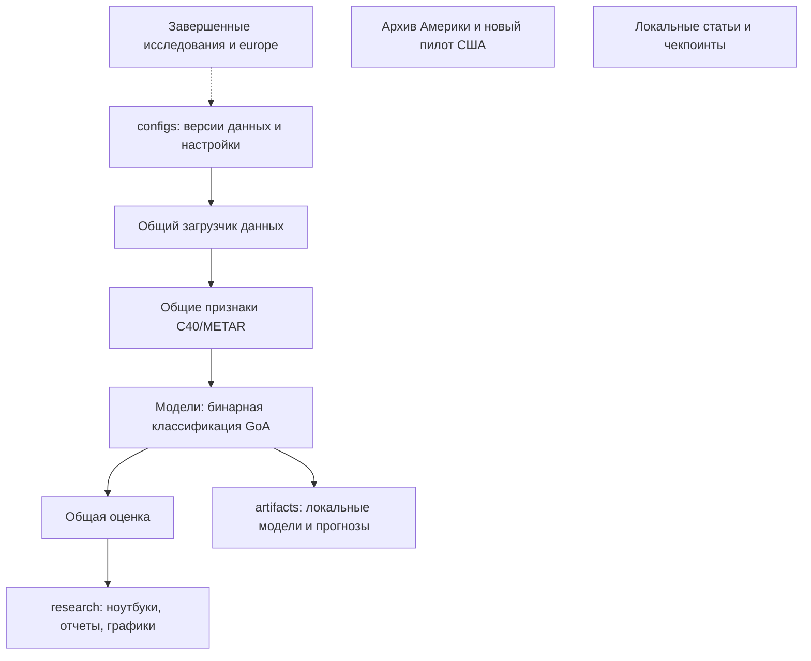

# Архитектура Approach Risk

Общий код находится в src/approach_risk: data — реестр и проверенная
загрузка; features — строгий выбор предикторов; models — семейства моделей;
evaluation — классификационные метрики, пороги и интервалы. Каталог configs
содержит версии данных и настройки экспериментов. research содержит постановку,
ноутбуки и публичные результаты конкретных исследований. Локальные модели
новых запусков сохраняются в artifacts, исходные/производные данные — data.
Эти локальные каталоги исключены из Git.

## Переход без потери воспроизводимости

Завершенные исследования, их код, модели и входы сохранены на прежних местах.
configs/datasets.json ссылается на готовую таблицу и фиксирует хеши манифеста
и реестра признаков; манифест фиксирует 93 выходных хеша. Новые эксперименты
используют имя europe_c40_model_v1 через общий API. Физический перенос данных
не выполнен: он не нужен для устранения прямой зависимости нового кода
от соседней исследовательской папки и потребовал бы миграции старых запусков.
Старые joblib используют comparison_pipeline.NumericPreparation; старый
модуль сохраняется для совместимости. Новые модели используют пакет.

europe остается историей подготовки, archive — историей Америки 2019,
новый пилот США хранится отдельно. Articles и Checkpoint локальны, вне Git.
Выделение c40_geometry в самостоятельный GitHub-проект остается отдельной
задачей для IT Города/резюме. Пакет не включает сырые данные или рукописи.

## Использование

Для разработки можно установить пакет: `.venv/Scripts/python.exe -m pip install -e . --no-deps`.
Сценарии текущей миграции добавляют src явно и не требуют установки.
Для запуска вне репозитория можно задать APPROACH_RISK_PROJECT_ROOT.
Проверка без обучения: `.venv/Scripts/python.exe scripts/verify_shared_architecture.py`.
Входы бустинга: `.venv/Scripts/python.exe research/boosting-weather-comparison/scripts/check_inputs.py`.
pyproject описывает общие зависимости; requirements.txt сохраняет прежнюю
среду подготовки документов/ноутбуков и не является новым полным lock-файлом.

