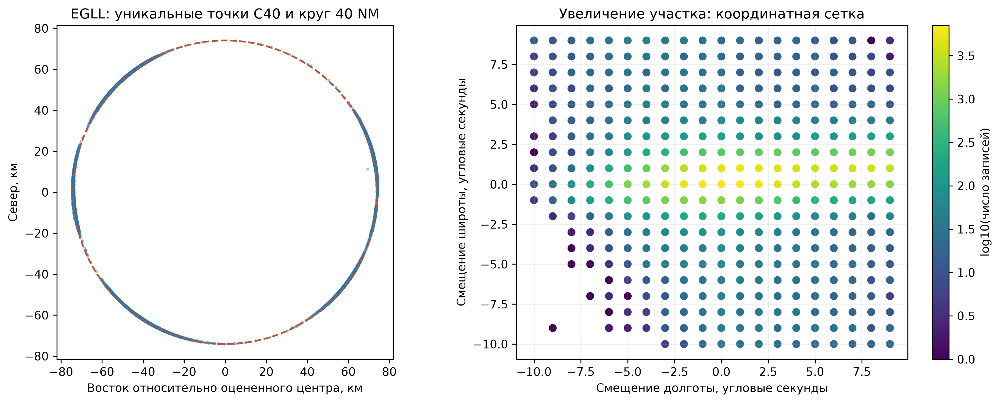

# 07_07 – Почему повторяется геометрия C40

## Источник полей

[Figuet et al., 2023, разделы 2.2–2.3](https://journals.open.tudelft.nl/joas/article/download/7219/5898): C40 получен из EUROCONTROL Correlated Position Reports, а метки посадочных сегментов – из OpenSky. ASMA описана как область радиуса 40 NM вокруг опорной точки аэропорта. [Zenodo](https://zenodo.org/records/10210178) определяет координаты и bearing как положение и направление у входа. Это не обязательно сырые координаты ADS-B в сохраненном OpenSky-сегменте. Публичный ноутбук автора читает готовый Parquet; сохраненный материал не содержит алгоритма получения C40 или точности координат. Указанный ниже механизм квантования установлен численно, его конкретный этап в цепочке источника не подтвержден.

## Проверка координатной сетки

Для координаты в градусах $x$ проверяем расстояние до целого количества угловых секунд:

$$\epsilon(x)=\left|3600x-\operatorname{round}(3600x)\right|.$$

Диагностический числовой допуск: $\epsilon<10^{-7}$ угловой секунды. Это допуск проверки floating point, не точность измерения самолета. Сетка $1/3600$ градуса соответствует одной угловой секунде. Линейный шаг на сфере:

$$\Delta s_\varphi\approx R\frac{\pi}{180\cdot3600},\qquad
\Delta s_\lambda\approx R\cos\varphi\frac{\pi}{180\cdot3600}.$$

При $R=6371008.8$ м: около 30,9 м по широте; по долготе шаг зависит от широты. Это шаг представления, не оценка погрешности наблюдения. Если координаты квантуются, разные положения попадают в одну ячейку. Повторение точки у разных полетов возможно без дублирования полета.

## Проверка зависимости bearing от координат

Для начального сферического азимута от точки 1 к точке 2, в радианах:

$$y=\sin(\lambda_2-\lambda_1)\cos\varphi_2,$$
$$x=\cos\varphi_1\sin\varphi_2-\sin\varphi_1\cos\varphi_2\cos(\lambda_2-\lambda_1),$$
$$\theta=\operatorname{atan2}(y,x)\pmod{2\pi}.$$

Проверяем обе ориентации: аэропорт → точка и точка → аэропорт. Это направление между точками, не курс самолета. Угловая ошибка с учетом цикличности:

$$r_i=\big((\hat\theta_i-\theta_i+180)\bmod360\big)-180.$$

Постоянный центр каждого аэропорта оценивается минимизацией $\sum_i r_i^2$. Половина отсортированных уникальных координат служит подгонке, другая – проверке; для подгонки берется систематическая подвыборка; фактические размеры сохранены в таблице результатов. Одна координата не входит одновременно в подгонку и проверку. Метка GoA в подгонке не используется. Это числовая проверка функции, не оценка качества ML-модели. Оцененные центры не являются официальными историческими опорными точками аэропортов.

Радиус проверяем по сферической формуле:

$$a=\sin^2\frac{\varphi_2-\varphi_1}{2}+\cos\varphi_1\cos\varphi_2\sin^2\frac{\lambda_2-\lambda_1}{2},\qquad
d=2R\arcsin\sqrt a.$$

$40\ \mathrm{NM}=74.08$ км. Расстояние на сфере – диагностическое приближение; отличие от 74,08 км само по себе не является ошибкой. Независимые официальные координаты и эллипсоидальная геометрия здесь не проверены.

## Результаты

На секундную сетку попадают **12,662,970 из 12,662,970 значений координат**. Максимальный остаток: 5.82e-11 угловой секунды. Число координатных пар, которым соответствуют разные точные значения bearing: **0**.

| airport | direction | p99_abs_error_deg | radius_median_km | radius_q01_km | radius_q99_km |
| --- | --- | --- | --- | --- | --- |
| EDDB | airport_to_point | 1.307398634e-12 | 74.09116517 | 73.81066117 | 74.39963281 |
| EDDF | airport_to_point | 1.335820343e-12 | 74.12712797 | 73.85149636 | 74.36479585 |
| EDDM | airport_to_point | 1.648459147e-12 | 74.05954218 | 73.86923983 | 74.25925293 |
| EGCC | airport_to_point | 1.421085472e-12 | 74.15633011 | 73.87026418 | 74.53015832 |
| EGLL | airport_to_point | 5.314859663e-12 | 74.09280546 | 73.77311799 | 74.35406923 |
| EGSS | airport_to_point | 1.591615728e-12 | 74.14578183 | 73.8662207 | 74.29143805 |
| EHAM | airport_to_point | 1.392663762e-12 | 74.15728939 | 73.83083247 | 74.45735689 |
| EIDW | airport_to_point | 1.421085472e-12 | 74.06200804 | 73.73598339 | 74.45038302 |
| EKCH | airport_to_point | 1.278976924e-12 | 74.08807559 | 73.79180754 | 74.36341767 |
| EPWA | airport_to_point | 1.364242053e-12 | 74.04241746 | 73.77878091 | 74.29056818 |
| ESSA | airport_to_point | 1.591615728e-12 | 74.06347804 | 73.74036245 | 74.54008506 |
| LEMD | airport_to_point | 1.47792889e-12 | 73.98112535 | 73.69300326 | 74.4808702 |
| LFPG | airport_to_point | 1.307398634e-12 | 74.1306016 | 73.87736747 | 74.39839651 |
| LFPO | airport_to_point | 2.529532139e-12 | 74.07674955 | 73.83673707 | 74.30548434 |
| LIMC | airport_to_point | 1.591615728e-12 | 74.03643765 | 73.79069969 | 74.18757821 |
| LIRF | airport_to_point | 1.335820343e-12 | 74.12144906 | 73.83866441 | 74.33298035 |
| LOWW | airport_to_point | 1.421085472e-12 | 74.06526511 | 73.77711438 | 74.32004212 |
| LSGG | airport_to_point | 1.449507181e-12 | 74.07168743 | 73.87018344 | 74.32964535 |
| LSZH | airport_to_point | 1.335820343e-12 | 74.09850768 | 73.8689422 | 74.3295312 |

## Что это означает для повторов и модели

Сначала читаем числовые результаты: квантование координат, постоянство bearing для пары координат и ошибка восстановления азимута проверяют разные части гипотезы. Маленькая ошибка на других координатах дает свидетельство вычислительной зависимости bearing от координат и центра; она не подтверждает точность слежения, источник округления или правильность сопоставления записи с полетом.

Связь подтверждена численно: три поля не являются тремя независимыми измерениями. Bearing может быть удобным преобразованием геометрии; при моделировании сравним варианты признаков после окончательного допуска, без удаления исходных значений. Повторная геометрия сама по себе не повод удалять запись. Для нейтрального сравнения используем одинаковые временные границы и тест.

Предыдущая проверка 07_06 уже показала: частые профили встречаются у разных бортов и дат, а составной ключ посадки в выбранных группах не повторяется. Квантование объясняет возможность точных совпадений; частота отдельных ячеек также может зависеть от маршрутов и структуры движения, что без траекторий не установлено.

## Границы вывода

Сырые CPR и алгоритм формирования C40 отсутствуют. Нельзя установить, округлялись ли координаты при хранении, передаче, подготовке EU-NM или при сборке этой таблицы. Траектории независимо не проверены. Решения о пригодности признаков и первый/последний вход C40 здесь не пересматриваются. Все записи и значения сохраняются.

## Установленный результат – проверка на всех строках

После подгонки на уникальных точках формула дополнительно проверена **на всех 6,331,485 строках**. Максимальное абсолютное расхождение направления: **5.85e-12°**. Во всех 19 аэропортах успешно восстановлена ориентация **аэропорт → точка C40**. Для каждой точной пары координат внутри аэропорта bearing одинаков. Численно это вычислительная зависимость с точностью floating point; bearing не несет отдельного независимого измерения сверх аэропорта и координат.

Повторы объясняются конечной координатной сеткой: одинаковые сохраненные координаты дают одинаковый вычисленный азимут. Шаг сетки установлен во всех строках, но конкретный этап округления и причины частого попадания в отдельные ячейки остаются неизвестными. Возможная концентрация движения по определенным направлениям требует отдельной траекторной проверки.

Радиальные медианы по аэропортам составляют 73.981–74.157 км и согласуются с геометрией границы 40 NM (74,08 км) в выбранном сферическом приближении. Это не независимая валидация официальной границы: центр восстановлен из самих полей. **Расстояния 140–147 км в 07_06 были расстояниями до медианы точек входа, а не до аэропорта.** Медиана точек, сосредоточенных на одной стороне окружности, может лежать далеко от центра; большие расстояния до нее не означают ошибочный C40.

Практический вывод: все записи и исходные поля сохраняем. При подготовке признаков можно сравнить азимут (например, sin/cos), координаты и их совместное использование. Поле bearing не является курсом самолета или направлением ветра. Окончательное решение о признаках еще не принято.
