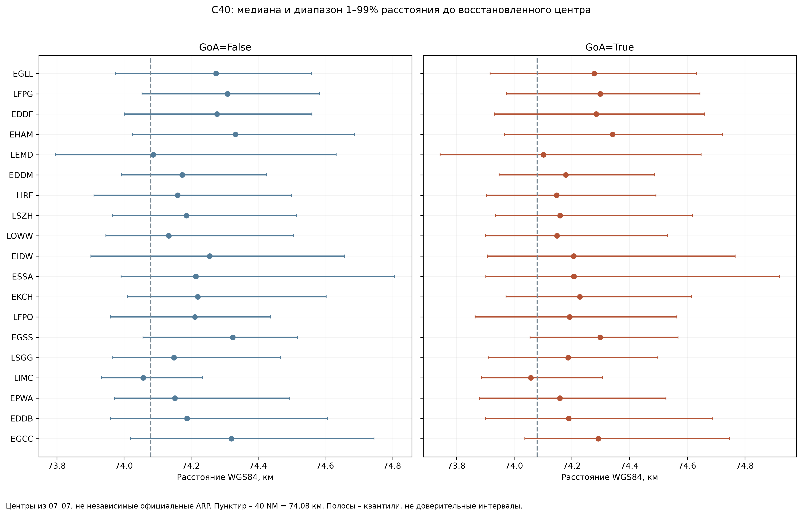

# 07_08 – Радиальные отклонения и частые точки C40

## Что проверяем

В 07_07 восстановлена постоянная точка, от которой вычислено направление C40. Теперь считаем расстояние от нее до каждой точки входа. Это не независимая валидация официального ARP: центр восстановлен из самих данных. Система координат источника отдельно не подтверждена; WGS84 используется как явная расчетная гипотеза.

$$\Delta d=d-74.08\ \mathrm{км},\qquad 40\ \mathrm{NM}=74.08\ \mathrm{км}.$$

Проверяем сферу из 07_07 и эллипсоид WGS84. Для эллипсоида использована обратная формула Vincenty: $a=6378137$ м, $f=1/298.257223563$, $b=a(1-f)$, приведенная широта $U=\arctan((1-f)\tan\varphi)$. Итерационно решается разность долгот на вспомогательной сфере; итоговое расстояние $s=bA(\sigma-\Delta\sigma)$ с поправками Vincenty. Реализация проверена по [официальному примеру NGS](https://www.ngs.noaa.gov/PC_PROD/Inv_Fwd/readme.htm) на GRS80 и [примеру GeographicLib](https://geographiclib.sourceforge.io/html/python/examples.html) на WGS84 с допуском 2 мм. Контроль сходимости выполнен для всех строк; установка дополнительных библиотек не требовалась.

Пороги $|\Delta d|>1$ км и $>3$ км – диагностические списки для просмотра, не авиационные нормы и не правила очистки. Второй список входит в первый. Ни один порог не оценивает точность C40 или границы ASMA.

## Сводка радиальных отклонений

| Аэропорт | n | Отклонение >1 км | Отклонение >3 км | >1 км, % | Мин., км | Макс., км |
| --- | --- | --- | --- | --- | --- | --- |
| EDDB | 148336 | 2 | 0 | 0.001 | 72.953 | 75.068 |
| EDDF | 604960 | 32 | 2 | 0.005 | 68.750 | 78.610 |
| EDDM | 443203 | 13 | 0 | 0.003 | 73.432 | 76.544 |
| EGCC | 87435 | 6 | 0 | 0.007 | 73.014 | 75.628 |
| EGLL | 631718 | 3 | 1 | 0.000 | 70.403 | 75.111 |
| EGSS | 221348 | 13 | 3 | 0.006 | 67.679 | 77.191 |
| EHAM | 561481 | 15 | 4 | 0.003 | 69.773 | 78.233 |
| EIDW | 263879 | 9 | 1 | 0.003 | 71.443 | 77.204 |
| EKCH | 243272 | 9 | 2 | 0.004 | 70.978 | 78.498 |
| EPWA | 177752 | 4 | 1 | 0.002 | 67.081 | 74.798 |
| ESSA | 243823 | 20 | 0 | 0.008 | 72.153 | 75.429 |
| LEMD | 515044 | 2 | 0 | 0.000 | 71.840 | 76.460 |
| LFPG | 617562 | 25 | 1 | 0.004 | 71.319 | 78.000 |
| LFPO | 236603 | 2 | 0 | 0.001 | 71.696 | 75.327 |
| LIMC | 196397 | 7 | 0 | 0.004 | 71.659 | 75.219 |
| LIRF | 322749 | 11 | 2 | 0.003 | 64.816 | 76.846 |
| LOWW | 293578 | 2 | 1 | 0.001 | 69.674 | 75.009 |
| LSGG | 205372 | 3 | 0 | 0.001 | 72.624 | 75.467 |
| LSZH | 316973 | 0 | 0 | 0.000 | 73.507 | 74.948 |

За границами диагностического интервала 74,08 ± 1 км: **178 записей (0.0028%)**, включая **4 GoA=True**. Отклонение более 3 км: **18 записей**. Максимальная разница между сферой и WGS84 в этой выборке: **272.0 м**. Смена модели Земли не должна автоматически объяснять многокилометровый хвост.

## Конкретные крайние записи

| flight_id | icao24 | airport | GoA | radius_sphere_km | radius_wgs84_km | minutes_c40_to_first_attempt |
| --- | --- | --- | --- | --- | --- | --- |
| ARG1140_145542 | e07211 | LIRF | False | 64.726 | 64.816 | 13.267 |
| ARG1140_145632 | e07211 | LIRF | False | 65.978 | 66.094 | 18.050 |
| ENT73JH_21100 | 489221 | EPWA | False | 66.954 | 67.081 | 13.067 |
| ROJ004_78586 | 896448 | EGSS | False | 67.541 | 67.679 | 2.217 |
| EIN6JY_152276 | 4ca788 | EDDF | False | 68.580 | 68.750 | 8.233 |
| DLH1AC_25204 | 3c5463 | EDDF | False | 78.579 | 78.610 | 12.600 |
| NAX932_16926 | 479f4f | EKCH | False | 78.371 | 78.498 | 10.100 |
| AUA26_33678 | 440081 | LOWW | False | 69.538 | 69.674 | 15.267 |
| KLM680_59736 | 484f73 | EHAM | False | 69.652 | 69.773 | 102.500 |
| TRA46R_141788 | 4853d4 | EHAM | False | 78.005 | 78.233 | 12.433 |

Все записи первого диагностического списка сохранены в `07_08_radial_records.csv` с исходными идентификаторами, координатами, UTC-временами и списками попыток. Значения C40 и GoA каждой записи побитово не сравнивались, но их числовое/временное равенство исходному Parquet проверено без допусков по составному ключу. Во всех этих записях C40 раньше первой отмеченной попытки; исходные ключи не повторяются. Значит, хвост существовал уже в исходнике и не появился при текущей подготовке.

Механизм отклонений не установлен. Возможны отличия расчета пересечения, редкая периодичность/интерполяция CPR, границы сегмента или сопоставление источников, но это гипотезы без исходных CPR. По одному радиусу нельзя объявить полет или координату ошибочными.

## Самая частая точная точка каждого аэропорта

| airport | rows | go_arounds | aircraft | dates | months | share_airport_percent |
| --- | --- | --- | --- | --- | --- | --- |
| EGLL | 7089 | 12 | 1684 | 1124 | 53 | 1.122 |
| LFPG | 4456 | 3 | 1025 | 972 | 53 | 0.722 |
| EGSS | 4269 | 11 | 592 | 1219 | 53 | 1.929 |
| LFPO | 3291 | 2 | 523 | 640 | 50 | 1.391 |
| EIDW | 1583 | 2 | 624 | 763 | 52 | 0.600 |
| LSZH | 1579 | 4 | 602 | 879 | 53 | 0.498 |
| EDDM | 1327 | 2 | 539 | 615 | 51 | 0.299 |
| LEMD | 1151 | 1 | 379 | 743 | 50 | 0.223 |
| EDDF | 996 | 3 | 466 | 542 | 48 | 0.165 |
| LIRF | 836 | 2 | 457 | 498 | 45 | 0.259 |
| LSGG | 831 | 3 | 461 | 524 | 51 | 0.405 |
| ESSA | 722 | 3 | 411 | 466 | 43 | 0.296 |
| LOWW | 486 | 1 | 147 | 357 | 46 | 0.166 |
| EGCC | 317 | 1 | 270 | 214 | 22 | 0.363 |
| EPWA | 306 | 0 | 134 | 226 | 28 | 0.172 |
| EHAM | 218 | 0 | 176 | 193 | 44 | 0.039 |
| LIMC | 184 | 1 | 156 | 157 | 47 | 0.094 |
| EDDB | 172 | 1 | 138 | 155 | 30 | 0.116 |
| EKCH | 83 | 0 | 66 | 74 | 24 | 0.034 |

Точка выбрана по частоте во всей актуальной выборке аэропорта; метка не участвовала в выборе. Число разных бортов и дней показывает, сосредоточено ли повторение в одном борте/коротком периоде. Повторов составного ключа посадки в этих группах нет. Значения, округленные для оформления таблиц, не использовались для определения точных групп.

Полные записи: `07_08_dominant_point_records.csv`. Месячные количества и доля внутри каждого класса: `07_08_dominant_point_months.csv`. Типы отдельно по классам: `07_08_dominant_point_types.csv`. Месяцы без событий выбранной точки отсутствуют в таблице профиля; календарная таблица радиальных групп содержит знаменатели для их восстановления.

Повторы согласуются с установленной секундной сеткой и сосредоточением входов в отдельных местах. Связь с конкретными опубликованными маршрутами или процедурами не подтверждена. Высокая частота геометрии не подтверждает дубль физического полета.

## Статус и дальнейшее решение

Все значения и записи сохраняются, новых исключений нет. Представлены диагностические материалы; механизм радиального хвоста без CPR не подтвержден. Нельзя переносить диагностические флаги в модель как признаки причины GoA. Следующее решение касается достаточности проверки для продолжения исследования, а не обязательного удаления хвоста. Для модели можно запланировать сравнение вариантов геометрии и проверку чувствительности к диагностическим группам на общем тесте после окончательного допуска признаков.

## Проверка состава диагностических групп

Наибольшее число записей с радиальным отклонением более 1 км: EDDF – 32, LFPG – 25, ESSA – 20, EHAM – 15, EGSS – 13. Это ранжирование абсолютных чисел, а не вероятностей.

Всего в хвосте 176 разных ICAO24; временное покрытие 2019-02-05 22:39:42+00:00 – 2023-04-27 11:43:53+00:00. Состав по бортам, дням и месяцам сохранен в `07_08_tail_composition.csv`. Месяцы с наибольшей долей хвоста – в `07_08_tail_months_review.csv`, вместе с n каждой метки: малый знаменатель нельзя интерпретировать как массовую проблему.

Наиболее частая точная точка: EGLL, 7089 записей (1.122% аэропорта), 1684 бортов, 1124 дней и 53 месяцев. Здесь 12 GoA=True; доля 0.169% против 0.380% во всем аэропорте. Это описательное сравнение без календарной и погодной корректировки, не оценка влияния направления.

Цифровая точность координат и точный расчет bearing объясняют совпадение числовой геометрии. Источник многокилометровых радиальных отклонений остается открытым; в проверенных записях подтверждены исходные значения и допустимый временной порядок C40, но не соответствие CPR физическому полету.
