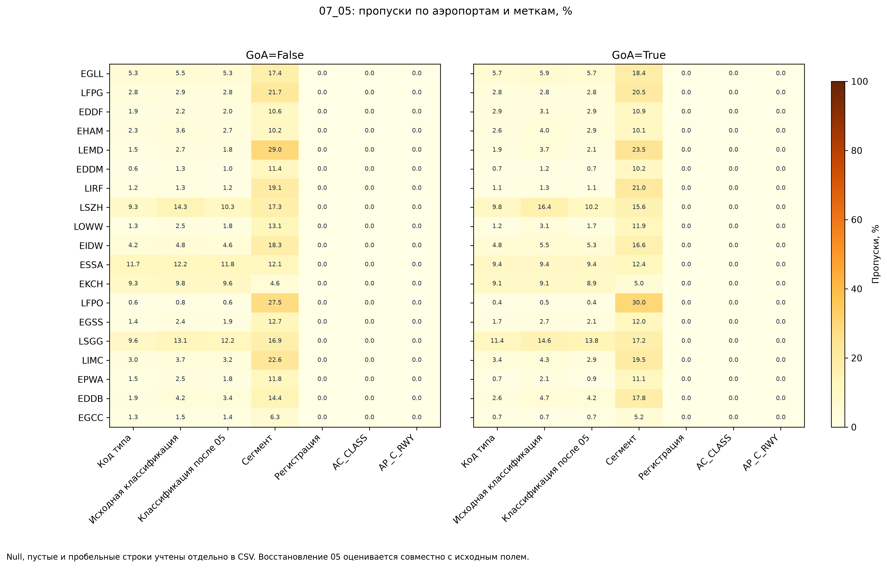
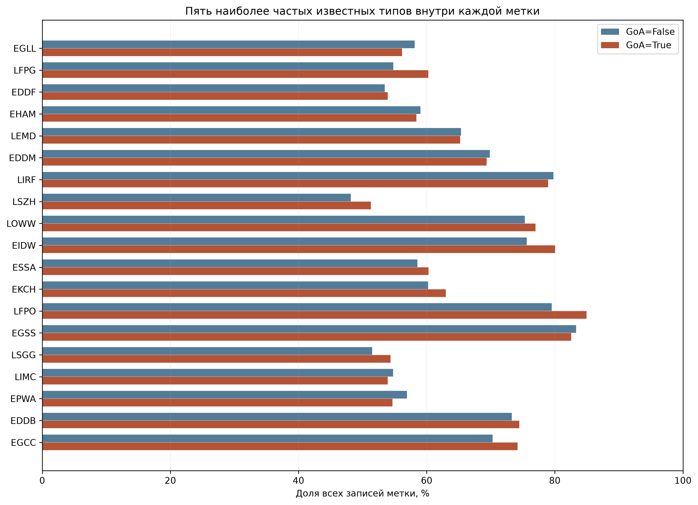

# 07_05 – Состав типов и пропуски по аэропортам

Проверены все 6,331,485 записей актуальной выборки, включая 18,349 GoA=True. Аэропортов: 19. Вход подтвержден SHA256 отчета 07_01. Состав и значения не изменены.

## Состав обеих меток

| Аэропорт | n False | n True | Типов False | Типов True | Первый тип False | Первый тип True |
| --- | --- | --- | --- | --- | --- | --- |
| EDDB | 147909 | 427 | 213 | 50 | B738 | B738 |
| EDDF | 603076 | 1884 | 196 | 58 | A320 | A320 |
| EDDM | 441910 | 1293 | 200 | 58 | A320 | A320 |
| EGCC | 87129 | 306 | 137 | 33 | B738 | B738 |
| EGLL | 629318 | 2400 | 68 | 41 | A320 | A320 |
| EGSS | 220717 | 631 | 182 | 32 | B738 | B738 |
| EHAM | 560443 | 1038 | 204 | 64 | B738 | B738 |
| EIDW | 262957 | 922 | 184 | 44 | B738 | B738 |
| EKCH | 242710 | 562 | 176 | 33 | B738 | B738 |
| EPWA | 177185 | 567 | 189 | 42 | E195 | B738 |
| ESSA | 243186 | 637 | 180 | 40 | B738 | B738 |
| LEMD | 514058 | 986 | 201 | 48 | B738 | B738 |
| LFPG | 615216 | 2346 | 156 | 56 | A320 | A320 |
| LFPO | 235859 | 744 | 82 | 26 | B738 | B738 |
| LIMC | 195950 | 447 | 196 | 44 | A320 | A320 |
| LIRF | 322283 | 466 | 147 | 29 | A320 | A320 |
| LOWW | 292557 | 1021 | 209 | 67 | A320 | A320 |
| LSGG | 204844 | 528 | 218 | 58 | A320 | A320 |
| LSZH | 315829 | 1144 | 229 | 60 | A320 | A320 |

## Пропуски и восстановление

Классификация недоступна в исходном поле у 281,738 записей; после дополнения описанием этапа 05 – у 243,798. Пропуск восстановленного описания сам по себе не означает отсутствие классификации: поле заполнялось только для части записей. Итоговая доступность не подтверждает корректность классификации.

Наибольшие различия доли пропусков между метками (описательное ранжирование):

| Аэропорт | Поле | Пропуски False, % | Пропуски True, % | True − False, п.п. |
| --- | --- | --- | --- | --- |
| LEMD | market_segment | 29.04 | 23.53 | -5.51 |
| EDDB | market_segment | 14.42 | 17.80 | 3.38 |
| LIMC | market_segment | 22.61 | 19.46 | -3.15 |
| LFPO | market_segment | 27.47 | 29.97 | 2.51 |
| ESSA | classification_unavailable | 11.84 | 9.42 | -2.42 |
| ESSA | typecode | 11.73 | 9.42 | -2.31 |
| LIRF | market_segment | 19.11 | 21.03 | 1.92 |
| LSGG | typecode | 9.58 | 11.36 | 1.79 |
| EIDW | market_segment | 18.34 | 16.59 | -1.74 |
| LSZH | market_segment | 17.27 | 15.56 | -1.71 |
| LSGG | classification_unavailable | 12.16 | 13.83 | 1.66 |
| LFPG | market_segment | 21.70 | 20.46 | -1.24 |

## Интерпретация и ограничения

Количество известных типов и их концентрация зависят от объема группы; малый положительный класс нельзя считать сопоставимой по полноте описью флота. Первая категория и пять наиболее частых типов выбираются отдельно внутри каждой метки. Знаменатель включает записи с отсутствующим типом.

Различия состава и пропусков не доказывают влияние типа на GoA. Они могут смешивать аэропорт, календарь, сегмент и справочное обогащение. Total variation в CSV – половина суммы абсолютных различий долей категорий, от 0 до 1; категория пропуска включена, временное смешение не устранено. Это описательная дистанция, не тест значимости и не правило удаления.

Категориальные коды сохранены как есть: регистр и варианты кодов не объединены. Null, точные пустые строки и пробельные строки подсчитаны раздельно. Для итоговой классификации исходное непустое значение дополняется непустым восстановленным описанием; формат и историческая корректность здесь не подтверждены.

`07_05_monthly_missing.csv` показывает пропуски типа и сегмента по месяцам и обеим меткам. `07_05_review_records.csv` содержит до трех конкретных примеров каждой группы аэропорт × метка × проверяемое поле: исходные идентификаторы и значения сохранены, выбор первых записей не является случайной выборкой. Эти записи – материал для проверки происхождения пропуска, а не ошибки и не кандидаты автоматического удаления.

Метаданные C40 проверены на null. Доступность справочника до C40 и допустимость признаков для модели решаются позднее. GoA=False – отсутствие отмеченного ухода, а не независимое подтверждение нормального профиля. Старые исключения и пороги не переносятся.

## Решение – 09.10.2026

Пользователь решил **сохранить все записи**: пропуски справочных полей и различия состава не являются основанием для новых исключений. Состав выборки и исходные значения не изменены. Предыдущие решения этапов 04–06 сохраняются.

При моделировании сравнить варианты с этими справочными полями и без них, с подходящей для каждой модели обработкой пропусков. Использование полей в окончательной модели еще не определено. Проверка должна использовать одинаковую тестовую выборку и временные границы; доступность полей к C40 проверяется до включения. Эксперименты еще не выполнены.

Решение по сохранению записей в 07_05 принято. Следующий шаг – 07_06, распределения числовых полей отдельно для GoA=True и GoA=False.
