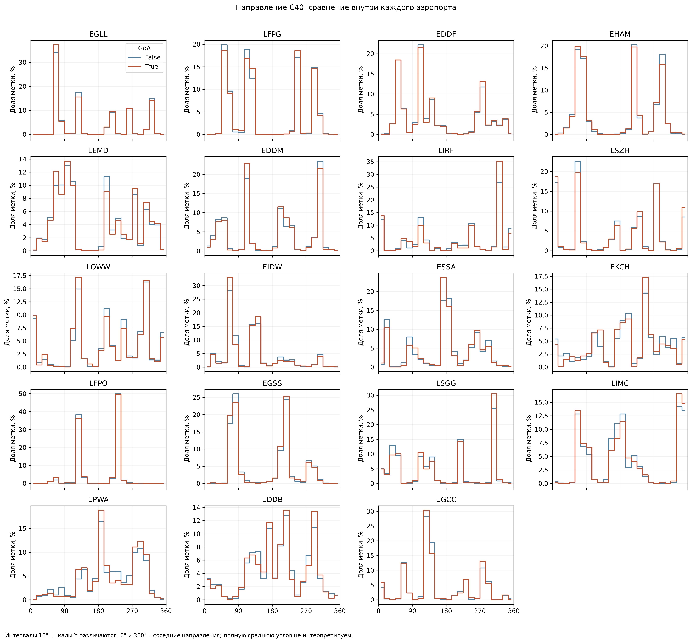
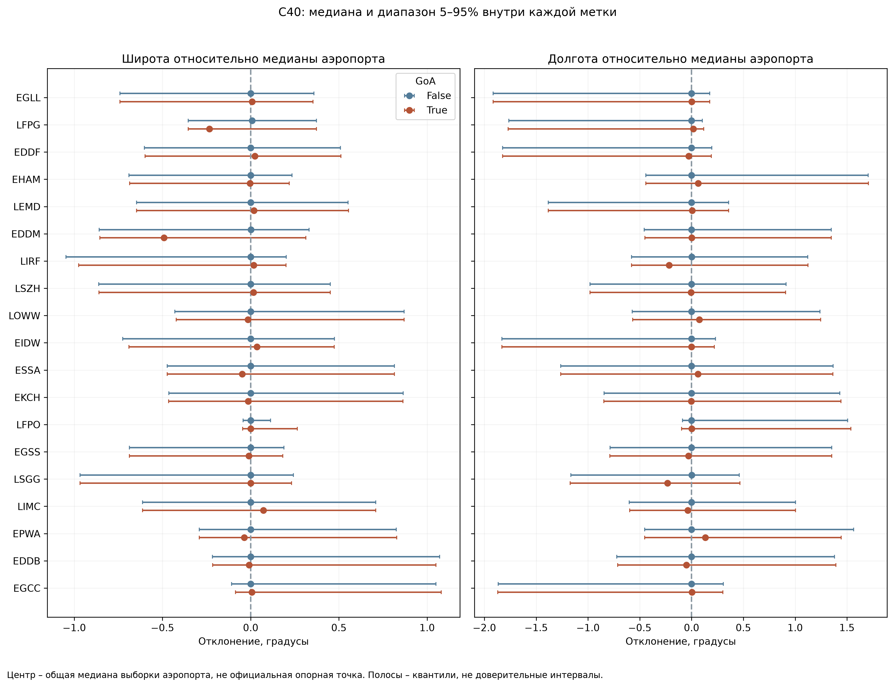
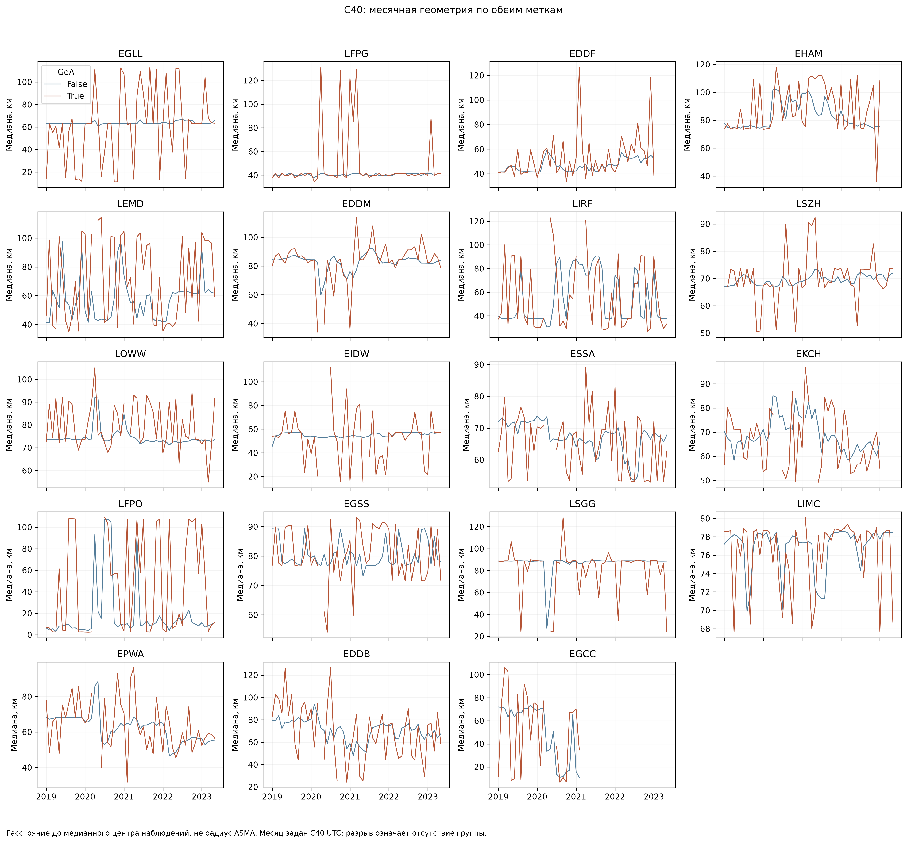

# 07_06 – Распределения направления и координат C40

Проверены 6,331,485 записей и обе метки по 19 аэропортам. Диагностические нарушения диапазонов или нечисловые значения: **0**. Все исходные значения сохранены.

## Направление

Направление циклическое: 359° и 1° близки. Гистограммы нормированы отдельно внутри меток. В таблицах есть круговая средняя и длина результирующего вектора от 0 до 1; малое значение означает слабую концентрацию вокруг средней и может возникать при нескольких противоположных пиках. Среднее не заменяет просмотр полного распределения. Числовые квантили исходного угла сохранены только как описание значений на шкале [0,360), не как циклический интервал.

## Координаты

Глобальное распределение координат смешивает географию разных аэропортов. Поэтому сравнение выполнено внутри каждого аэропорта и относительно общей медианы его наблюдений, без использования метки при выборе центра. Этот центр вычислен для описательного аудита и не является подготовленным признаком модели: если такой признак потребуется, его параметры оцениваются на обучающей части.

## Временная динамика

Группировка по месяцу C40 UTC. Полные n каждой метки, координатные медианы и круговые показатели направления сохранены в `07_06_monthly.csv`. Месяцы малого положительного класса могут давать неустойчивые показатели. Плавность или скачок линии не подтверждают изменение авиационного риска.

## Повторяющиеся профили и конкретные записи

Округленная диагностическая группа: аэропорт, целый градус направления (округление вниз), широта и долгота до 0,01°. Наиболее частые три группы каждого аэропорта сохранены в `07_06_frequent_profiles.csv`; исходные записи – в `07_06_profile_records.csv`. Округление не меняет вход, близость профилей не доказывает дубликат: одна геометрия может повторяться у обычных заходов.

В выбранных группах точных совпадений трех числовых полей с повтором: 22,550 групп, 1,315,615 записей. Это ограниченная проверка выбранных групп, не глобальный поиск содержательных дублей. Идентификаторы и времена сохранены для проверки разных бортов и периодов.

В `07_06_review_records.csv` сохранены 114 конкретных записей: три наиболее удаленные от медианного центра внутри каждой группы аэропорт × метка и все нарушения диапазонов. Расстояние вычислено по сфере радиуса 6371,0088 км; это диагностический порядок просмотра, не нормативный порог и не расстояние до официального центра аэродрома.

## Решение и следующий разбор

Новых исключений и исправлений нет. Выборка сохраняется по решениям 07_04 и 07_05. Отличие распределений не устанавливает причинную связь и не подтверждает пригодность поля для прогноза. Следующий разбор – конкретные повторяющиеся и наиболее удаленные профили, с проверкой времени, бортов и исходных значений. Погодные признаки для всей выборки еще не присоединены. Окончательный допуск признаков и временное разбиение выполняются после аудита.

## Дополнительная проверка точных повторов

В 1 319 933 записях выбранных частых округленных групп повторов составного ключа `icao24 + airport + landing_time` не найдено. Числовая геометрия повторяется у разных записей; совпадение трех числовых полей не является содержательным дублем.

Самая многочисленная точная комбинация в выбранных группах: **EGLL**, направление 72.22890287°, широта 51.67638889°, долгота 0.56166667°. Она встречается в **7,089 записях**, у **1,684 адресов бортов**, на **1,124 UTC-днях**; GoA=True: 12. Диапазон времени C40: 2019-01-09 04:16:06+00:00 – 2023-05-29 04:45:40+00:00.

Сводка двадцати наиболее частых точных комбинаций с числом бортов и дат: `07_06_exact_profile_identity_review.csv`. Механизм повторения числовой геометрии пока не установлен; необходимо проверить происхождение и вычисление C40 по источнику. Нельзя считать эти повторы ни ошибкой, ни независимым подтверждением одинаковой траектории. Исходные значения и записи сохраняются.
