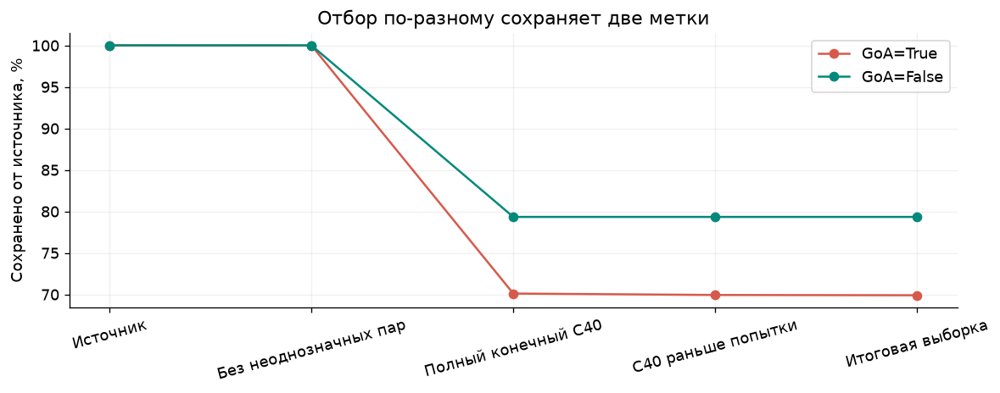

> Статус на 11.10.2026: этап сохранен в закрытой Approach Risk ver. 1.0. Развитие продолжается в Approach Risk ver. 1.1. [Итог проекта](../../README.md). Ниже сохранено описание исследовательской линии.

# Как отбор данных меняет оценку моделей GoA

**Статус: исследование завершено, 10.10.2026.** Зафиксированы описательный аудит, временная оценка базовых моделей и исследовательские проверки после просмотра test. Практическая пригодность моделей не подтверждена; дальнейшие эксперименты в эту завершенную работу не входят.

Воспроизводимое исследование формирования аналитической выборки и ретроспективной оценки ухода на второй круг. Сопоставляем исходные события, покрытие признаками и результат фиксированных моделей. Историческая доступность C40 остается условной.

**Начать чтение:** [`12_results.ipynb`](notebooks/12_results.ipynb).
За наблюдаемый период 2023 прогнозами покрыты 1739 из 2810 исходных GoA
(61,89%). Recall геометрической модели составляет 44,16% внутри покрытия,
а доля найденных исходных GoA – 27,33%. Полные метаданные оставляют 92
test-записи без GoA. Это результаты о популяции и знаменателе оценки,
без подтверждения эксплуатационной пригодности.

[`Ревью`](reports/research_review.md), [`расширенный обзор`](literature/04_evaluation_review.md)
отделяют измеренные результаты от ограничений. Публикационная рукопись хранится отдельно от репозитория.
Исследовательские дополнения после просмотра test обозначены явно.

Основной артефакт – [`notebooks/01_selection_effects.ipynb`](notebooks/01_selection_effects.ipynb): постановка вопроса, протокол, проверка происхождения, потоковые расчеты, таблицы, графики и ограничения интерпретации. [`notebooks/02_group_effects.ipynb`](notebooks/02_group_effects.ipynb) разбирает потери меток по группам и этапам. Все исследовательские расчеты находятся в ячейках. Скрипты только собирают и исполняют ноутбуки.

[`notebooks/03_selection_structure.ipynb`](notebooks/03_selection_structure.ipynb) углубляет результат: совместный разрез аэропорт × месяц, арифметическое разложение изменения частоты, подробный разбор покрытия LTFJ/EGCC/EIDW и пересечения отсутствующего типа с C40. Первичный обзор находится в [`literature/01_selection_review.md`](literature/01_selection_review.md).

[`notebooks/04_temporal_feature_availability.ipynb`](notebooks/04_temporal_feature_availability.ipynb) начинает эксперимент B: контракт всех 35 полей, условное покрытие исходных метаданных и ретроспективный интервал C40 до первого зарегистрированного захода. Полнота поля не считается доказательством его доступности при прогнозе.

## Что сравниваем

[`10_selection_evaluation.ipynb`](notebooks/10_selection_evaluation.ipynb)
связывает source/final/test точными ключами, сравнивает требования к метаданным
и отделяет GoA вне покрытия от FN внутри него.
[`11_model_comparison.ipynb`](notebooks/11_model_comparison.ipynb) добавляет
train-only ориентир аэропорта, одинаковые ранговые бюджеты и чувствительность
bootstrap к блокам 1/2/4 недели. Модели 08 не переобучаются.

[`notebooks/09_errors.ipynb`](notebooks/09_errors.ipynb) разбирает фиксированные
test-прогнозы по аэропортам, месяцам и missing / unseen типам. Пороги и модели
не меняются. Публикуются пересечения тревог, баланс ошибок, нагрузка FP и
арифметическое разложение разницы Brier по аэропортам.

[`notebooks/08_baseline.ipynb`](notebooks/08_baseline.ipynb) обучает первый
ретроспективный baseline: константный прогноз и две логистические регрессии.
Все параметры fit на train, C / пороги выбираются на validation, затем
оцениваются фиксированные модели на одном test. Недельный парный bootstrap
оценивает неопределенность на test без переобучения моделей.

[`notebooks/07_feature_preparation.ipynb`](notebooks/07_feature_preparation.ipynb)
проверяет диапазоны и категории, рассчитывает словари / параметры стандартизации
только train и фиксирует план оценки. До подтверждения семантики bearing и
AC_CLASS они остаются отдельными условными вариантами. Основные кандидаты
содержат геометрию C40, UTC-признаки и, во втором варианте, исходные типы самолетов.

[`notebooks/06_time_split.ipynb`](notebooks/06_time_split.ipynb)
оформляет условные наборы C40 с метаданными самолета / без них, единые
календарные части и проверку повторных записей. market_segment не обязателен;
пропуски метаданных не удаляют строки. Обучение не выполняется.

[`notebooks/05_metadata_calendar_audit.ipynb`](notebooks/05_metadata_calendar_audit.ipynb)
сравнивает календарную полноту четырех исходных полей в источнике и финале,
совместные пропуски, словарь сырых значений и границы наблюдаемого покрытия.

1. Полный исходный массив событий.
2. Массив без ранее согласованных неоднозначных пар C40.
3. Записи с заполненными конечными числовыми полями C40.
4. Записи с C40 строго раньше первой попытки.
5. Финальную выборку после согласованных исключений отдельных случаев.

Для каждого этапа вычисляем объем и частоту GoA, сохранение обеих меток, изменения состава по аэропортам, годам, месяцам UTC, исходным типам самолетов и сегментам. Сохраненные и не вошедшие наблюдения сравниваются отдельно. Причины отбора имеют последовательный приоритет; таблица пересечений сохраняется отдельно.

## Запуск

Проверенное окружение: Python 3.14 и версии из `requirements-lock.txt`.
`requirements.txt` задает диапазоны зависимостей; в текущем проекте используется `.venv`.

```powershell
python -m pip install -r research/sample-selection/requirements.txt
python research/sample-selection/scripts/execute_notebook.py
python research/sample-selection/scripts/execute_notebook.py 02_group_effects.ipynb
python research/sample-selection/scripts/execute_notebook.py 03_selection_structure.ipynb
python research/sample-selection/scripts/execute_notebook.py 04_temporal_feature_availability.ipynb
python research/sample-selection/scripts/execute_notebook.py 05_metadata_calendar_audit.ipynb
python research/sample-selection/scripts/execute_notebook.py 06_time_split.ipynb
python research/sample-selection/scripts/execute_notebook.py 07_feature_preparation.ipynb
python research/sample-selection/scripts/execute_notebook.py 08_baseline.ipynb
python research/sample-selection/scripts/execute_notebook.py 09_errors.ipynb
python research/sample-selection/scripts/execute_notebook.py 10_selection_evaluation.ipynb
python research/sample-selection/scripts/execute_notebook.py 11_model_comparison.ipynb
python research/sample-selection/scripts/execute_notebook.py 12_results.ipynb
python research/sample-selection/scripts/verify_artifacts.py
python research/sample-selection/scripts/review_artifacts.py
```

Ноутбуки также можно открыть в Jupyter и выполнить все ячейки сверху вниз. Сборка через `scripts/build_notebook.py` нужна только после редактирования генератора; она очищает старые результаты первого ноутбука. Полный пересчет может занять десятки минут: читается полный массив, проверяются контрольные суммы и все записи четырех ключевых этапов. В память загружается один блок по 100 000 записей и агрегаты. Второй ноутбук работает за несколько секунд на готовых таблицах. Проверенные версии прямых зависимостей записаны в `requirements-lock.txt`.

## Полученный результат

Источник содержит 7 984 254 записи с 26 253 метками GoA; итоговая выборка – 6 331 485 записей с 18 349 GoA. Сохранено 79,30% всего массива, 69,89% GoA=True и 79,33% GoA=False. Частота метки меняется с 0,3288% до 0,2898%: −0,0390 процентного пункта, или −11,86% относительно исходной доли.

Основной вклад – пропуски C40: 1 652 382 записи и 7 847 GoA. LTFJ полностью отсутствует в итоговой популяции после условия полноты C40. Из записей с отсутствующим исходным typecode сохраняется 16,62%. Наблюдаемый период – январь 2019 – май 2023; последний год неполный.



SHA256 входов, совпадение реконструированных подмножеств и балансы всех групп проверены. Результат характеризует состав данных; он не доказывает ошибочность меток или причинный механизм пропусков.

При разложении по аэропортам × месяцам изменение весов дает −0,01581 п.п., изменение долей внутри совместных групп – −0,02319 п.п. Компоненты зависят от группировки и используют исходные доли как опору. Различие не сводится к изменению календарного или аэропортового состава.

После описательной стандартизации по общим стратам аэропорт × месяц сохраняется 90,98% записей с указанным типом и 19,45% без типа. Это сравнение наблюдаемых групп, без доказательства причины и без корректирующего взвешивания модели.

## Выделение в самостоятельный репозиторий

Папка является корнем исследования. Внешние входы задаются переменной `SAMPLE_SELECTION_DATA_ROOT`: это каталог с подкаталогами `europe/data/` и `europe/reports/`. Если переменная не задана, используется корень родительского Approach Risk. Импорта его скриптов нет.

```powershell
$env:SAMPLE_SELECTION_DATA_ROOT = 'D:\datasets\approach-risk'
python scripts/execute_notebook.py
python scripts/execute_notebook.py 02_group_effects.ipynb
python scripts/execute_notebook.py 03_selection_structure.ipynb
```

Точный контракт входов приведен в `DATA_REQUIREMENTS.md`, а фактически прочитанные файлы и SHA256 – в `reports/verification.json`. Сырые данные и чекпоинты не входят в Git. Лицензия кода и условия распространения данных требуют отдельного решения перед публикацией; автоматически лицензия не назначается.

## Результаты

Графики используют коралловый `#D65A4A` и зеленый `#00897B`, с их светлыми
оттенками для дополнительных категорий. Тепловые карты полноты зеленые;
шкалы знаковых различий проходят от зеленого через белый к коралловому.

- `reports/selection_summary.csv` – полный объем и эффект каждого перехода.
- `reports/comparison_{airport,year,month,typecode,market_segment}.csv` – источник, финал и не вошедшие записи по группам.
- `reports/by_*_all_stages.csv` – состав на всех этапах.
- `reports/exclusive_reasons.csv`, `rule_overlap.csv` – причины и пересечения.
- `reports/stage_registry.csv` – историческая цепочка преобразований и отбора.
- `reports/verification.json`, `environment.json` – проверка и окружение.
- `figures/` – рисунки PNG и SVG; те же графики встроены в ноутбук.
- `reports/findings.md` – выводы, рассчитанные из фактических результатов.
- `reports/rate_decomposition.csv`, `structure_findings.md` – разложение долей и углубленные выводы.
- `reports/joint_*.csv` – совместные разрезы, этапы и шаблоны пропусков.
- `reports/zero_coverage_windows.csv` – непрерывные наблюдаемые месяцы без финального покрытия.
- `reports/type_missing_standardization.json` – описательная стандартизация сохранения по статусу типа.
- `literature/` – первичный обзор и BibTeX; границы прочтения указаны явно.

Разбор фиксированных прогнозов: `reports/errors_*.csv`,
`errors_verification.json`, [интерпретация ошибок](reports/errors_interpretation.md).
Ноутбук 09 сравнивает ошибки по аэропортам, месяцам и состояниям метаданных,
не обучая модели и не меняя пороги.

## Ограничения

GoA – исходная метка, без независимого подтверждения эксплуатационного исхода. Единица анализа – запись события; `flight_id` не считается уникальным. Потоковая проверка сравнивает порядок, кратности, составные ключи, GoA и C40 в каноническом представлении; она не проверяет каждую колонку или глобальную уникальность ключа.

Эксперимент A – описательный анализ полного доступного массива. Различия не доказывают причинный механизм пропусков и сами по себе не оценивают качество модели. Современное обогащение типов не объявляется доступным при историческом прогнозе. Новые исключения и исправление меток здесь не выполняются; кандидатный split не меняет базу A. Ноутбук 08 выполняет отдельное ретроспективное baseline-моделирование по плану B.

Эксперимент B публикует отчеты `temporal_*`, `metadata_*`, `protocol_*`, `preparation_*`, `baseline_*`.
Дополнения: `selection_evaluation_*`, `comparison_reference_*`, `comparison_budget_*`,
`comparison_equal_budget.csv`, `comparison_block_*` и `study_*`.
Историческая доступность сообщений и справочников пока не подтверждена, поэтому baseline
не считается эксплуатационной валидацией. Test неполный, без EGCC/LTFJ, парк
преимущественно знакомый. Новый подбор требует независимой финальной оценки.
Рабочая рукопись описывает эмпирический аудит отбора; новизна алгоритма и принятие
статьи не заявляются.
